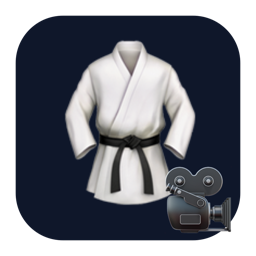

<!--
  PORTADA DEL REPOSITORIO PÚBLICO DE DESCARGAS.

  No se edita allí: el trabajo `publicar` de .github/workflows/instaladores.yml copia este archivo
  como README.md del repositorio público en cada release, junto con la licencia y el aviso de
  terceros. Cualquier cambio hecho a mano en el otro repositorio se pierde en la siguiente
  publicación; se edita aquí.
-->

# JudoReplay

**El vídeo de apoyo al arbitraje del tatami: el sistema CARE.**

---

## Qué es

Graba la cámara de los árbitros de cada tatami y les deja revisar las acciones: rebobinar, cámara
lenta, fotograma a fotograma y zoom. Desde **la mesa del comisionado** se ven todos los tatamis por
la red local del pabellón, sin depender de internet, y se puede ir directo a cualquier combate.

La misma aplicación hace los dos trabajos: **CARE** en el equipo de cada tatami, o **comisionado**
en su mesa.

Es un cliente de [**JudoAdministración**](https://github.com/JuSaFe/JudoAdministracion-Releases).
No tiene base de datos propia ni funciona sola: se conecta por HTTPS al mismo servidor que los
puestos de administración, con las mismas credenciales y en la misma red local del pabellón.

## Instalación

Descarga el instalador de tu sistema desde la [**última versión**](../../releases/latest):

| Sistema | Archivo |
|---|---|
| Windows 10/11 (x64) | `.exe` |
| macOS (Apple Silicon) | `.dmg` |
| Linux (x64) | `.AppImage` |

Es **autocontenido**: no hace falta instalar .NET en el equipo. Sí hace falta un servidor de
[JudoAdministración](https://github.com/JuSaFe/JudoAdministracion-Releases) ya en marcha en la misma
red, con licencia de JudoReplay, y un usuario con rol `replay` (CARE) o `comisionado`.

Para grabar, el equipo del tatami necesita un **codificador de vídeo por hardware** H.265 o AV1
(Intel 6.ª generación o posterior, NVIDIA, AMD o Mac). La propia aplicación lo comprueba.

Los instaladores llevan **FFmpeg** (LGPL 2.1 o posterior), compilado sin codificadores de vídeo por
software. Sus binarios y su código fuente, con el guion que lo compila, están en las releases
`ffmpeg-*` de este repositorio (ver [TERCEROS.md](TERCEROS.md)).

## Soporte

¿Un fallo, una duda o una propuesta? Abre una
[**incidencia**](../../issues/new) describiendo qué ocurre, en qué sistema y con qué versión.

El desarrollo se lleva en un repositorio privado; este de aquí es el punto de descarga y el canal
de incidencias.

## Licencia

Software **de código propietario y uso gratuito**. Texto completo en **[LICENSE](LICENSE)**.

**Se permite**, gratis y sin límite de equipos, usuarios ni tiempo:

- Descargar, instalar y ejecutar el programa, incluso con fines profesionales o comerciales.
- Redistribuirlo **íntegro y sin modificar**, a título gratuito y conservando todos los avisos.

**No se permite** modificarlo, crear obras derivadas, distribuir versiones modificadas, republicarlo
en otro repositorio ni reutilizar partes de él en otros proyectos.

La **propiedad intelectual del programa es de Juan Cotolí San Félix**.

> **Marcas y logotipos.** Los escudos federativos que incluye la aplicación son propiedad de sus
> respectivas entidades y no están cubiertos por esta licencia.

Las bibliotecas de terceros que incorpora se rigen por sus propias licencias, detalladas en
[TERCEROS.md](TERCEROS.md).

---

Hecho para el tatami. 🥋🎥

